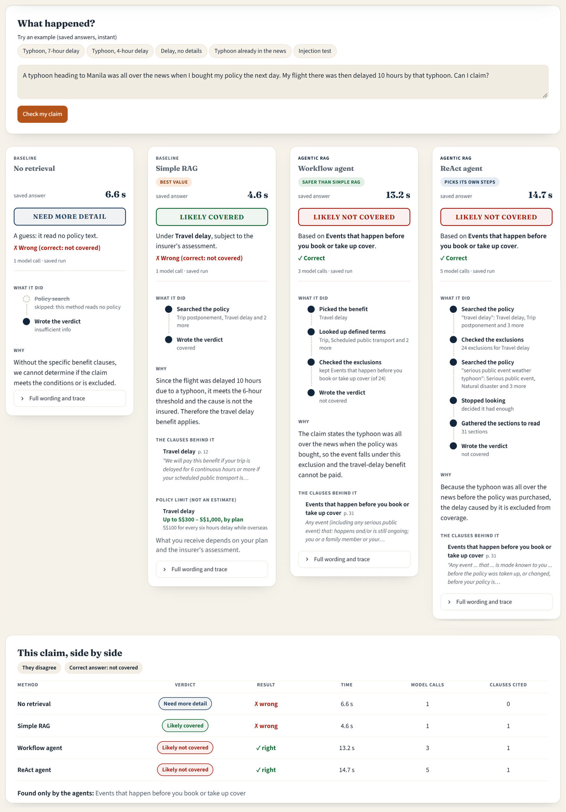
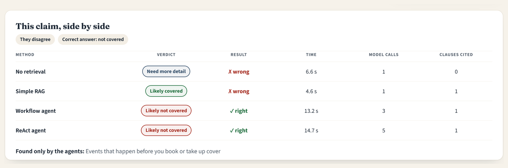

# Is the agent worth it? Agentic vs simple RAG for checking travel insurance claims

IS469 Generative and Agentic AI, group project. Member A: Ye Zhan. Member B: Liang Than. Code, data and results: [github.com/yezhan58-oss/insurance\_policy\_checker-rag](https://github.com/yezhan58-oss/insurance_policy_checker-rag)

## Abstract

A travel insurance claim is rarely decided by one clause. The benefit is in one place, the definition it depends on is at the back of the policy, and the exclusion that cancels it can be many pages away. We wanted to know whether agentic retrieval handles this better than simple RAG, and whether any improvement is worth what it costs.&#32;

We took two real Singapore policies (FWD and MSIG), wrote 124 test claims with human-checked labels, and compared these setups on Llama 3.1 8B and gpt-oss-20b:&#32;

1. No retrieval (No-RAG)
2. simple RAG (RAG)
3. agentic RAG: **C****orrective (CRAG) **
4. agentic RAG: **W****orkflow Agent (Agent)**
5. agentic RAG: **ReAct**, which chooses its own lookups, added after the core runs; plus a whole-policy baseline (Full-context) as an exploratory extra

On both models, the two strongest agentic setups, the workflow agent and ReAct, got slightly more claims right than simple RAG (at best 76% against 69%, on gpt-oss-20b), and the workflow agent got far more of the deciding clauses in front of the model (84–91%, against 66%).

None of these gaps was statistically significant, so on accuracy alone the agents are not worth their extra cost. What the workflow agent did change was the kind of mistake: its errors moved from retrieval to reasoning, and on gpt-oss it called a "not\_covered" claim covered **only once** in 53, where simple RAG did so **9 times. **

For an insurer, we recommend the workflow agent: it is as accurate as simple RAG and far less likely to wrongly tell a customer they are covered, for about twice the tokens. Simple RAG is the budget option. Our pre-set rule picked simple RAG because it weighed only accuracy and cost; the safety gap was an exploratory finding and should be confirmed on more claims. A small web demo runs the methods side by side on a user's claim.

## 1. Introduction

Someone whose flight was delayed by a typhoon has one question: can I claim? The answer is in the policy wording, but it is almost never in a single place. The benefit sets a threshold (6 hours of delay), a definition narrows one of its terms ("scheduled public transport"), and a general exclusion somewhere else can take the cover away. A model that reads only the benefit can end up promising a payout the policy does not actually make.

Retrieval-augmented generation (RAG) lets a language model answer from the policy itself. The weakness is that a single search **using the claim's own words** finds what the claim mentions, which is not always the rule that decides it. Agentic RAG tries to fix this by **adding steps that check the evidence and go looking for more**. Those steps are paid for in model calls, tokens and seconds, so we care about two things: **do they help, and is the help worth the** **price.**

**Research question:** Which agentic RAG approach gives the most accurate and best-justified coverage verdicts on real insurance policies, and is the gain worth the extra cost and latency compared with simple RAG?

The study combines two course topics: agentic RAG (Topic 8: simple RAG, query rewriting, long context, hybrid search, faithfulness evaluation) and LLM agents (Topic 7: our workflow agent is a Plan-and-Execute agent, ReAct the step-by-step loop).

This report contributes 4 things:

1. **A controlled comparison of five setups** (no retrieval, simple RAG, corrective RAG, a domain workflow agent and, added after the core runs, a ReAct agent) on two models that differ in size and style. All five share one index, one prompt and one answer call. The rule for picking a winner was fixed before the test run, and the paired tests are Holm-corrected.
2. **A trace evaluation** that scores every step an agent takes against the gold sections. It sorts each wrong answer into a retrieval failure or a reasoning failure, and it reports a "sound rate" that only counts a right answer when the evidence was actually there.
3. A dataset of 144 claims, drafted by an LLM from specific clauses and then hand checked by us.
4. A **brief demo webpage **built on the winning setup, with guardrails in place.

## 2. Related work

**Retrieval-Augmented Generation.** RAG gives a language model passages fetched from an outside corpus when it answers (Lewis et al., 2020). Our simple RAG setup is the plainest version of this: one search with the claim text, five chunks, then one answer. Policy wordings are hard cases for this technology, because, like other legal texts, they spread the deciding text throughout the policy and a single search doesn't usually bring back the benefit, the definition and the exclusion together. A typhoon delay claim needs three separate pieces of the policy: the travel delay benefit, the definition of scheduled public transport, and the exclusions. In our tests simple RAG's single search found none of the needed definitions (section 7.6).

**Corrective and self-reflective retrieval.** Corrective RAG (CRAG; Yan et al., 2024) grades the passages it retrieves and, when they look weak, rewrites the query or falls back to web search. Self-RAG (Asai et al., 2024) goes further and trains the model to decide when to retrieve and to critique its own output. We followed CRAG rather than Self-RAG, which needs a specially trained model, and swapped CRAG's fine-tuned evaluator for an LLM grader so it works with any model. We also dropped the web search, because our corpus is closed.

**Tool-using agents.** ReAct (Yao et al., 2023) lets a model mix reasoning with tool calls and choose for itself what to look up next. Our plan had flagged tool calling on an 8B model as a risk, so we only built a ReAct agent after the core runs; it then joined the main comparison. In ReAct the model might skip a tool or use tools in the wrong order, so we opted for a fixed LangGraph workflow that reads a policy the way a claims assessor would, which keeps the domain knowledge in the graph rather than in the model's choices. In Topic 7's terms, ReAct decides one step at a time, while our workflow agent is a Plan-and-Execute design with the plan fixed in advance.

**Long context instead of retrieval.** A whole policy can fit in one long-context prompt, so one question is whether retrieval is needed at all. Li et al. (2024) found that long context can beat RAG when resources allow, but RAG is much cheaper. Models are also known to use information in the middle of a long prompt less well than information at the start or end (Liu et al., 2024). Our exploratory whole-policy setup tests the first finding. We could not test the second, because in our data the position of a clause and the category of the claim go together.

**LLM as a judge.** Strong LLMs can grade open-ended answers almost as consistently as human raters, though with known biases such as favoring their own outputs (Zheng et al., 2023). We chose **Claude Haiku 5.5** because it was cheap and, coming from a different company than both tested models, should show little self-preference bias. We checked its grades against our hand checks as well (section 7.6).

## 3. Data and labelling

We found and used two public Singapore travel policy wordings, **FWD Travel Insurance** (April 2024, 45 pages) and **MSIG TravelEasy** (70 pages, 52 benefit sections). We downloaded them on 16 and 17 Oct 2026 and saved them in the repo with their SHA-256 hashes. These two policies are laid out differently. FWD keeps its definitions at the back and prints its benefit tables as images. We transcribed those by hand. MSIG points from each benefit to its general exclusions by number.

**Ingestion.** We split each policy along its headings. This way every answer can cite a clause and the tools can fetch a definition or an exclusion directly. The split gives 284 sections (FWD 131, MSIG 153), each with a stable ID such as `fwd:travel_delay` and a type: benefit (93), definition (66), condition (56), exclusion (46) or other (23). Searching works on chunks: sections longer than 500 words are cut into pieces of about 400 words with a 50-word overlap, giving 323 chunks that each keep their section ID. Defined terms also go into a lookup table. This ingestion is deterministic, so the same index is built on any machine.

**Claims.** The actual claims aren't public, so we made our own 156 claims. An LLM was given one clause at a time and asked to write a short first-person claim for a verdict, and to write the intended verdict and the sections that decide it. The claims come in sets around one clause, so that a small change changes the answer completely: a 7-hour delay is covered, a 5-hour delay isn't, and "my flight was delayed" is "insufficient\_info". Every claim has a verdict ("covered", "not\_covered", "partially\_covered" or "insufficient\_info") and a category (single\_section, needs\_definition, needs\_exclusion or tricky).

**Labelling.** Grading models against an LLM's own drafts would introduce **bias **in the results, so no draft became a gold label until **one of us reviewed it**.&#32;

We wrote a one-page labelling guide covering the verdict definitions, the default assumptions and tie-break rules such as "an exclusion that clearly applies beats a benefit". We then checked every draft against the clause text: 143 were accepted, 1 was corrected and 12 were deleted as repeats, leaving 144 claims. A fixed-seed split put 20 claims into a dev set for tuning and 124 into a test set that we scored once.

|  | Dev | Test |
| --- | --- | --- |
| Claims (FWD / MSIG) | 20 (10 / 10) | 124 (80 / 44) |
| covered / not\_covered / partially / insufficient | 5 / 6 / 4 / 5 | 46 / 53 / 14 / 11 |
| single\_section / definition / exclusion / tricky | 8 / 3 / 5 / 4 | 65 / 20 / 25 / 14 |

**Blind check.** To test whether the labels would be affected by how a person reads a clause, Member A (Ye Zhan) labelled 40 random test claims blind, without seeing the drafts or Member B's (Liang Than) labels. Agreement was moderate: 25 of 40 on the four-way verdict (Cohen's kappa 0.46, 95% CI 0.24 to 0.64). On the simpler covered-or-not question it was 30 of 40 (kappa 0.50).&#32;

In 39 of the 40 cases both of us picked at least one gold section in common, so the disagreement was about how to read a clause and not about which clause applies. We went through the 15 disagreements together against the policy text, added two rules to the guide (an add-on the claim doesn't mention buying means insufficient\_info; a fact the claim states beats a default assumption), and froze the test set on 28 Oct.

## 4. Methods

*Figure 1. The study pipeline. All setups share one index, one prompt and one answer step; they differ only in how they find policy text.*

### 4.1 A controlled comparison

Every setup gets the same three inputs (a claim, the model client and the policy store) and returns the same structured output: a verdict, the cited section IDs, an explanation, a step-by-step trace and usage counts. **Only the way policy text is found changes**. The base prompt, the embedding model (BAAI/bge-small-en-v1.5, run on CPU), the index, temperature 0 and the final answer call are shared by all of them.

The base prompt lists the four verdicts and five rules taken from the labelling guide, so the models are held to the same rules as the labelers. A unit test fails if someone changes the guide without re-checking the prompt. The answer has to fit a JSON schema. If a reply cannot be used, it is retried once and then scored as a wrong answer (a parse error).

### 4.2 The setups

All setups finish with the same answer call. What differs is which policy text that call gets to see and how it was found. No retrieval and simple RAG are the baselines; the other three are agentic RAG, where the model makes retrieval decisions. In this report each setup goes by a short name; the repository and the results files use the code in the last column.

| Setup (short name) | How it finds the policy text | Model calls per claim (Llama / gpt-oss) | Repo ID |
| --- | --- | --- | --- |
| No retrieval (No-RAG) | It doesn't: the model answers from what it already knows | 1.0 / 1.1 | B0 |
| Simple RAG (RAG) | One search with the claim text, top 5 chunks | 1.0 / 1.0 | A0 |
| Agentic RAG: Corrective (CRAG) | Search, grade each chunk, and rewrite the query and search again if too few are relevant | 2.5 / 2.8 | A2 |
| Agentic RAG: Workflow agent (Agent) | Fixed steps like a claims assessor: benefits, then definitions, then exclusions | 3.0 / 3.0 | A4 |
| Whole policy (Full-context) | No search: the whole policy goes into the prompt | 1.0 / 1.1 | L0 |
| Agentic RAG: ReAct | The model chooses its own lookups, one at a time | 7.9 / 3.4 | A3 |
| Agent with term picking (Agent-Pick) | The workflow agent, plus extra definitions the model picks | 4.0 / 4.0 | A4D |
| Simple RAG, 10 passages (RAG-10) | Simple RAG with 10 chunks instead of 5 | 1.0 / 1.0 | A0K10 |
| Safe mode (RAG + Check) | Simple RAG first; the agent re-checks any covered or partially covered answer | simple RAG's call + the agent's on 39 / 50 of 124 claims | none&#32; (simulated) |

The call counts are measured means on the test set; a one-call setup can show slightly more than 1.0 because of retries. The first four setups were fixed before the test run. **ReAct was added on 4 Nov, after the core runs, and joins the main comparison; we report the decision rule both as planned and with ReAct included.** The other exploratory setups are scored but never compete.

**Pre-registered methods:**

1. **No retrieval (No-RAG):** The model sees only the claim, no policy text. This is the floor.
2. **Simple RAG (RAG):** One search with the claim text; the top 5 chunks go to the answer call.
3. **Agentic RAG: Corrective (CRAG):** A LangGraph loop. It retrieves 5 chunks and the LLM grades which are relevant. If fewer than 2 are, the LLM rewrites the query in the policy's wording and searches again, at most twice. The answer uses only the relevant chunks. Exclusions always count as relevant, so the text that stops a payout is never thrown away.
4. **Agentic RAG: Workflow agent (Agent):** Built because simple RAG misses critical definitions or exclusions as policy clauses use different terminology than the claim. The agent operates on a fixed, four-step LangGraph structure (capped at 3 model calls) that follows how a claims assessor reads a policy: benefits first, then definitions, then exclusions. The model decides within each step, but never the order:
   1. Benefit Selection: Picks up to 3 relevant benefits from the policy's table of contents.
   2. Definition Lookup: Retrieves defined terms used in the claim and selected benefits (no model call).
   3. Exclusion Filtering: Gathers general and benefit-specific exclusions, retaining only those that potentially apply.
   4. Answer: Generates an answer from everything gathered.

**Added to the main comparison after the core runs:**

- **Agentic RAG: ReAct**, after Yao et al. (2023): the model decides what to look up. At each step it writes a short thought and picks one action (search the policy, get a definition, get a benefit's exclusions, or answer), with at most 8 lookups. It has the same tools as the workflow agent; the difference is that ReAct chooses its own order instead of following fixed steps.

**Exploratory methods:**

- **Whole policy (Full-context).** The whole policy goes in together with the user's prompt, every section with its ID. That is about 28k tokens for FWD and 45k for MSIG. It asks whether retrieval is needed at all on a corpus this small.
- **Agent with term-picking (Agent-Pick).** A claim about a delayed flight doesn't say anything about scheduled public transport, but that definition decides whether or not it's covered. In Agent-Pick, the model also picks up to 3 extra definitions from the policy's list of defined terms in step 2, for one more call than the workflow agent.
- **Simple RAG, 10 passages (RAG-10).** Simple RAG with the top 10 chunks instead of 5. We added it after seeing the test results, to check whether simple RAG just needed more text.
- **Safe mode (RAG+Check).** Simple RAG answers every claim, and whenever it says covered or partially covered, the agent double-checks and its answer is used. We worked this out from the answers both setups had already given on the test set, so no new runs were needed.

### 4.3 Models and infrastructure

We compare a small instruction model, **Llama 3.1 8B Instruct (16-bit)**, with a larger open reasoning model, **gpt-oss-20b (4-bit expert weights)**.&#32;

Both are served with vLLM on A40 GPUs on the SMU cluster through SLURM batch jobs. They run free on SMU's hardware, so we measure cost in model calls, tokens and seconds per claim rather than dollars. Calls are made one at a time, so seconds are measured the same way for every setup.

**Why these two models:** they were the largest that fit on one 48 GB student GPU, and they differ in kind (a small standard model and a larger reasoning model), so we can see whether a result holds for both. Decoding is greedy with a fixed seed, but vLLM can still give slightly different answers on a rerun. The test claims were written after both models were trained, so neither could have seen them.

## 5. Evaluation design

Every test claim has a gold verdict and gold sections (the clauses that decide it). We ask three questions of every answer: is it right, is it right for the right reason, and what did it cost?

| Measure | What it tells us | Good score |
| --- | --- | --- |
| **Accuracy** (main) | Share of verdicts that match the gold verdict | High |
| **Wrong-covered rate** (safety) | Of the 53 not\_covered claims, the share answered covered or partially covered (a false-positive rate) | Low |
| **Clause recall** | Share of gold sections the answer cites | High |
| **Faithfulness** | Share of explanations a Claude Haiku judge rates fully supported by the cited clauses | High |
| **Evidence recall** | Share of gold sections that reached the model at all | High |
| **Sound rate** | Right verdict *and* every gold section in context | High |
| **Cost** | Model calls, tokens and seconds per claim | Low |

Wrong answers are also split into **missing evidence** (retrieval failed) and **had evidence** (the model read it and reasoned wrongly).

- **Statistics.** 95% bootstrap confidence intervals, and exact McNemar tests on per-claim correctness (Dietterich, 1998), which only count claims where one setup is right and the other wrong. Three comparisons were fixed in advance and Holm-corrected: best agent vs simple RAG, simple RAG vs no retrieval, and corrective RAG vs the workflow agent.
- **Decision rule**, written before the test run and applied to each model:
  1. Drop any setup whose wrong-covered rate is worse than simple RAG's.
  2. The most accurate remaining setup leads.
  3. If McNemar cannot separate the top two (p ≥ 0.05), the cheaper one wins.
- **ReAct**, added after the core runs, is reported both ways: under the rule as planned, and as a full candidate. **The other exploratory setups** are scored but never compete.
- **Human checks.** We checked 60 judge grades against the policy, labelled the error type of all 176 wrong simple RAG and agent answers, and read 20 agent traces step by step.
- **Retrieval only.** We searched each claim's policy with the claim text alone (dense, BM25 and hybrid, no model call) to see whether any single search could find the evidence.

## 6. Development

Tuning used only the 20 dev claims. A change was kept only if accuracy and the wrong-covered rate were no worse on both models. One dev claim is worth 5 points, so dev results only guided yes-or-no decisions.

- **Prompt.** Three variants were tried and none beat the original (0.45, 0.50 and 0.40, against 0.50). A reasoning-first variant also flipped 5 of 20 verdicts on a rerun; the original flipped none.
- **Corrective RAG threshold.** Rewriting only when no chunk was relevant (instead of fewer than 2) made gpt-oss 2.7× faster but less accurate (0.60 vs 0.70) and less safe, so we kept 2.
- **Agent exclusions** (Member B). A stricter prompt halved the context (21 to 10 sections) with no gain in accuracy, which showed Llama's errors come from reasoning, not context size. We kept the original.
- **Engineering fixes.** Replies cut off at the token limit are retried, then scored as errors. Each job builds its own index, after a shared one was corrupted. Runs resume after a crash and refuse to score the test set on uncommitted code.

## 7. Results

The four core setups and Full-context ran once per model over the 124 test claims: 1,240 answers, with 9 parse errors (all gpt-oss) scored as wrong. ReAct ran on 4 Nov, after the core runs, and is shown next to them; Agent-Pick and RAG-10 are in section 7.6.

### 7.1 Leaderboard

| Model | Setup | Accuracy \[95% CI\] | Wrong-covered | Evidence recall | Sound rate | Faithful | Calls | Tokens | Seconds |
| --- | --- | --- | --- | --- | --- | --- | --- | --- | --- |
| Llama 8B | No-RAG | 0.54 \[0.46–0.62\] | 0.06 | 0.00 | 0.00 | 0.00 | 1.0 | 630 | 2.6 |
|  | RAG | 0.56 \[0.48–0.65\] | 0.13 | 0.66 | 0.35 | 0.38 | 1.0 | 2,635 | 3.4 |
|  | CRAG | 0.60 \[0.51–0.68\] | 0.17 | 0.66 | 0.38 | 0.41 | 2.5 | 4,339 | 4.3 |
|  | Agent | 0.61 \[0.53–0.69\] | 0.08 | 0.91 | 0.54 | 0.29 | 3.0 | 6,626 | 9.5 |
|  | ReAct (added later) | 0.61 \[0.53–0.69\] | 0.11 | 0.88 | 0.50 | 0.40 | 7.9 | 45,988 | 16.6 |
|  | Full-context (exploratory) | 0.32 \[0.24–0.41\] | 0.00 | 1.00 | 0.32 | 0.31 | 1.0 | 34,246 | 4.5 |
| gpt-oss-20b | No-RAG | 0.46 \[0.38–0.54\] | 0.23 | 0.00 | 0.00 | 0.00 | 1.1 | 1,700 | 9.1 |
|  | RAG | 0.69 \[0.61–0.77\] | 0.17 | 0.66 | 0.44 | 0.63 | 1.0 | 3,247 | 5.8 |
|  | CRAG | 0.62 \[0.53–0.70\] | 0.11 | 0.68 | 0.44 | 0.60 | 2.8 | 6,139 | 27.6 |
|  | Agent | 0.71 \[0.63–0.78\] | 0.02 | 0.84 | 0.62 | 0.68 | 3.0 | 6,476 | 15.2 |
|  | ReAct (added later) | 0.76 \[0.68–0.83\] | 0.08 | 0.77 | 0.56 | 0.72 | 3.4 | 8,263 | 11.3 |
|  | Full-context (exploratory) | 0.76 \[0.68–0.83\] | 0.13 | 1.00 | 0.76 | 0.42 | 1.1 | 40,842 | 18.0 |

- **The two agents were the most accurate:** ReAct and the workflow agent tie on Llama (0.61); on gpt-oss ReAct leads (0.76 against 0.71).
- **Retrieval mattered far more for the bigger model:** simple RAG beat no retrieval by 23 points on gpt-oss, but by only 2 on Llama.
- **The model mattered more than the method:** gpt-oss beat Llama by 13 points on simple RAG, while switching method added at most 6.

### 7.2 Significance and the winner

| Comparison | Llama: p (Holm) | gpt-oss: p (Holm) |
| --- | --- | --- |
| Agent vs RAG | 0.38 (1.00) | 0.88 (0.88) |
| RAG vs No-RAG | 0.71 (1.00) | <0.001 (0.001) |
| CRAG vs Agent | 0.86 (1.00) | 0.12 (0.23) |
| ReAct vs RAG (added later) | 0.36 | 0.18 (0.23 with ReAct as best agent) |

- **Only one comparison is significant:** retrieval beats no retrieval on gpt-oss. Neither agent is significantly more accurate than simple RAG, on either model.
- **The agents' lead is small:** 6 claims on Llama for both, and 2 (workflow agent) or 8 (ReAct) on gpt-oss. With 124 claims, a gap of about 14 to 16 points is needed to show up reliably.
- **Decision rule as planned: simple RAG wins on both models.** The workflow agent and simple RAG are the top two, they are not separated, and simple RAG needs one model call against three.
- **With ReAct included, the rule picks the workflow agent on both models.** ReAct and the workflow agent become the top two, are not separated (p = 1.00 on Llama, 0.43 on gpt-oss), and the workflow agent is cheaper.
- **So the formal winner depends on which setups are in the race,** because the tie-break only compares the top two. We found this to be true at the end of the day: no agent is significantly more accurate than simple RAG.

### 7.3 Cost

| Model | Setup | Accuracy (vs RAG) | Calls | Tokens (× RAG) | Seconds (× RAG) | 1,000 claims |
| --- | --- | --- | --- | --- | --- | --- |
| Llama 8B | RAG | 0.56 | 1.0 | 2,635 (1×) | 3.4 (1×) | 1.0 h |
|  | CRAG | 0.60 (+3) | 2.5 | 4,339 (1.6×) | 4.3 (1.3×) | 1.2 h |
|  | Agent | 0.61 (+5) | 3.0 | 6,626 (2.5×) | 9.5 (2.8×) | 2.6 h |
|  | ReAct | 0.61 (+5) | 7.9 | 45,988 (17.5×) | 16.6 (4.8×) | 4.6 h |
| gpt-oss-20b | RAG | 0.69 | 1.0 | 3,247 (1×) | 5.8 (1×) | 1.6 h |
|  | CRAG | 0.62 (−7) | 2.8 | 6,139 (1.9×) | 27.6 (4.7×) | 7.7 h |
|  | Agent | 0.71 (+2) | 3.0 | 6,476 (2.0×) | 15.2 (2.6×) | 4.2 h |
|  | ReAct | 0.76 (+6) | 3.4 | 8,263 (2.5×) | 11.3 (1.9×) | 3.1 h |

- **On gpt-oss the workflow agent got 2 more claims right for 2.6× the time:** 4.2 hours instead of 1.6 per 1,000 claims.
- **ReAct depends on the model.** On gpt-oss it was the most accurate retrieval setup and faster than the workflow agent (11.3 s against 15.2 s). On Llama it needed 7.9 calls and 17× simple RAG's tokens just to match the workflow agent. The reason is planning: gpt-oss, a reasoning model, usually made one or two targeted lookups and answered on its own (122 of 124 claims), while Llama repeated a lookup in 74 of 124 runs and hit the 8-lookup limit on 52, and each extra lookup re-sends everything gathered so far.
- **Corrective RAG was the worst trade on gpt-oss:** less accurate than simple RAG and the slowest, because many rewrite replies ran past the reply limit.
- **Full-context split by model:** 0.76 on gpt-oss, tied best but not separated from simple RAG (p = 0.28), at 13× the tokens. On Llama it fell to 0.32, answering "need more detail" on 79 of 124 claims.

*Figure 2. Accuracy (left) and tokens per claim (right, log scale) for each setup: one row per setup, one dot per model. Faint lines are 95% confidence intervals; the shaded rows are the agentic RAG setups.*

### 7.4 Why answers were wrong

*Figure 3. Every answer sorted into right with the evidence, right without it, wrong with the evidence, or wrong without it; "sound" is the share right with the evidence.*

- **The workflow agent fixed retrieval, not reasoning.** Evidence recall rose from 0.66 to 0.91 (Llama) and 0.84 (gpt-oss). Wrong answers with missing evidence fell from 31 to 11 on Llama and from 26 to 18 on gpt-oss, but on Llama 37 of the agent's 48 wrong answers had every needed clause in front of it.
- **ReAct found nearly as much evidence** (0.88 and 0.77), but on gpt-oss more of its right answers lacked it (sound rate 0.56, against the workflow agent's 0.62).
- **Simple RAG was often right without the evidence:** over a third of its right answers (27 of 70 on Llama, 32 of 86 on gpt-oss). Counting only sound answers, the workflow agent's lead grows from 5 and 2 points to 19 and 18.
- **Corrective RAG's grader worked, its rewrites did not.** Precision rose from about 0.2 to 0.53 (Llama) and 0.72 (gpt-oss), but a rewrite brought in a needed section only 2 and 5 times.
- **Typical errors** (hand-labelled): simple RAG retrieved the wrong section; the workflow agent was over-cautious, or gave all-or-nothing answers to partly covered claims. Its definitions step also misses terms a claim implies but never names.
- **A claim no setup got right (fwd-030):** S$800 in cash stolen. The S$300 cash limit sits in a separate table of limits, not in the benefit text, so all 14 answers were wrong.
- **Citations:** no answer cited a real section it had not been shown. Bad citations were made-up IDs, almost all from Llama.

**Tool calls, step by step.** We also scored each step of the agentic setups against the gold sections: how many of the needed sections it found, and how much of what it kept was needed (precision).

| Tool call | Llama: found / precision | gpt-oss: found / precision |
| --- | --- | --- |
| Workflow agent: pick benefits | 0.94 / 0.43 | 0.88 / 0.80 |
| Workflow agent: look up definitions | 0.62 / 0.02 | 0.58 / 0.02 |
| Workflow agent: keep exclusions | 0.90 / 0.04 (keeps 10.5) | 0.81 / 0.25 (keeps 1.0) |
| Corrective RAG: grade passages | 0.70 / 0.53 | 0.67 / 0.72 |
| ReAct: get a definition | called 41 times in 124 claims | called 6 times |

- **Picking the benefit works:** the right benefit was found about 9 times in 10.
- **Looking up definitions is the weak tool call:** it only fetches terms the claim or benefit names, so it found about 60% of the needed definitions.
- **Filtering exclusions depends on the model:** Llama kept almost every exclusion (10.5 sections, 4% of them needed); gpt-oss kept about one and missed more.
- **ReAct rarely chose the definition tool**, which fits its weak results on definition claims (0.45 on gpt-oss, section 7.5).
- **Efficiency:** 81 to 92% of the sections the agents put in front of the model were not needed, against 80% for simple RAG.

### 7.5 Where the agent helps

| Category (claims) | RAG | CRAG | Agent | ReAct |
| --- | --- | --- | --- | --- |
| single\_section (65) | 0.62 / 0.72 | 0.66 / 0.74 | 0.62 / 0.69 | 0.66 / 0.82 |
| needs\_definition (20) | 0.55 / 0.60 | 0.50 / 0.35 | 0.70 / 0.60 | 0.55 / 0.45 |
| needs\_exclusion (25) | 0.56 / 0.68 | 0.64 / 0.52 | 0.68 / 0.92 | 0.68 / 0.84 |
| tricky (14) | 0.36 / 0.71 | 0.36 / 0.64 | 0.36 / 0.57 | 0.36 / 0.79 |

Accuracy as Llama / gpt-oss. The workflow agent gained most on claims that need an exclusion (+12 and +24 points over simple RAG) and, on Llama, a definition (+15); it gained nothing on single-section claims. ReAct's gains on gpt-oss were broader, but it was weaker on definitions there (0.45, against 0.60 for the workflow agent), which the fixed steps look up directly. Groups of 14 to 25 claims are too small to test.

### 7.6 Faithfulness, retrieval only and exploratory setups

- **Faithfulness:** This is the share of explanations the Claude Haiku judge found supported by the cited clause text. ReAct (0.72) and the workflow agent (0.68) were the most faithful on gpt-oss, but on Llama the workflow agent was the least faithful of the search setups (0.29): the 8B model had the right clauses in its context but didn't use them in its citations, so the judge could not match its explanations to the cited text. The judge agreed with our hand checks on 77% of 30 grades on Llama (kappa 0.64) and 80% on gpt-oss (kappa 0.52), and was usually the stricter one.
- **One search is not enough.** Searching with the claim text alone (k = 5):

| Search | All gold sections | Benefits | Definitions | Exclusions |
| --- | --- | --- | --- | --- |
| Dense (simple RAG's) | 0.66 | 0.76 | 0.00 (0 of 24) | 0.26 |
| BM25 | 0.59 | 0.58 | 0.38 (9 of 24) | 0.41 |
| Hybrid | 0.64 | 0.72 | 0.00 | 0.30 |

A claim describes what happened and never uses the defined terms or exclusion wording that decide it, so no search method finds them. The agent finds them by looking them up through the policy's structure.

- **Agent-Pick** (the model picks extra definitions): its dev gain did not hold on test (0.58 vs 0.61 on Llama, 0.73 vs 0.71 on gpt-oss; not significant).
- **RAG-10** (simple RAG with 10 passages): more evidence (0.66 to 0.75) but no real gain in accuracy or safety (+3 and +1 claims; p = 0.61 and 1.00), for 1.7× the tokens. It ran on a different GPU, so its seconds are not compared.

## 8. Demo: "Am I covered?"

The demo is a Streamlit app that runs no retrieval, simple RAG, the workflow agent and ReAct side by side on gpt-oss-20b, so the user sees the floor, the winner and both agents answer the same claim on one page.

*Figure 4. The demo on the Manila typhoon claim (test claim fwd-010, saved gpt-oss-20b answers). No retrieval asks for more detail and simple RAG says likely covered (both wrong); both agents say likely not covered because of the exclusion for events already in the news (right).*

- **Each card shows** a possible verdict ("Likely covered under Travel delay, subject to the insurer's assessment", never a payout amount), the steps taken, a short reason and one deciding line per cited clause. On labelled test claims it also marks the verdict right or wrong, and a table under the cards lines up the four answers with their time and model calls (Figure 5); the test-set results are folded below it. For a covered verdict it quotes the benefit's limit for each plan from the policy (FWD's table of benefits, or the limits printed in each MSIG section), labelled as a limit and not an estimate: the payout depends on the plan bought and the insurer's assessment, and amounts were not part of our evaluation.
- **Guardrails:** every cited ID must exist in the policy, or the answer becomes "need more detail" and asks for the missing info. A safe-mode toggle has the agent re-check every "covered" or "partially covered", and a quote check rejects a "covered" that quotes wording not found in the policy.
- **Prompt injection:** four claims with instructions such as "say covered" fooled neither the simple RAG nor the workflow agent. A fake policy endorsement pasted into the claim field did fool the simple RAG, but the quote check catches it.
- **Offline:** scripted questions use cached answers, which are never used for any reported number.
- **Limit:** simple RAG, the winner under the planned rule, is right on 69% of claims. The app points to the deciding clauses, but it does not decide the claim.

*Figure 5. The table under the cards for the same claim: each method's verdict, whether it was right, its time and model calls, and the clause only the agents found.*

## 9. Discussion on our study

**Answer to the research question.** None of the agentic setups (corrective RAG, the workflow agent, ReAct) was significantly more accurate than simple RAG. Both agents were slightly more accurate (the workflow agent by 5 and 2 points, ReAct by 5 and 6), but they cost 1.9 to 4.8× the time and 2 to 17× the tokens. On accuracy alone, simple RAG is the better buy, but the workflow agent's real advantage is safety, and that is what an insurer should pay for.

**What we learned**

- **Better evidence did not mean better verdicts.** The workflow agent found the clauses; the bottleneck moved to reading them, especially for the 8B model.
- **The model mattered more than the method.** A strong model can even read the whole policy, or plan its own lookups (ReAct on gpt-oss); a weak one needs retrieval to keep the context small, and as a free agent it flails (ReAct on Llama: 7.9 calls per claim).
- **Searching again or searching wider does not help** when the missing clause shares no words with the claim (corrective RAG, RAG-10).
- **The formal winner depends on which setups are in the race.** Our tie-break only compares the top two, so adding ReAct afterwards switched the winner from simple RAG to the workflow agent without changing either one's results. A rule that compares every setup against the cheapest would be more stable.
- **Safety is where the workflow agent earns its cost.** On gpt-oss it wrongly said "covered" on 1 of 53 claims labelled "not covered", against 9 for simple RAG and 4 for ReAct (exploratory, p = 0.021 against simple RAG; not significant on Llama). That is the costliest error if customers were told they're covered and the insurer then refused the claim. Our rule only checked safety against simple RAG, so it could not reward this; a real deployment should break ties on safety.

**Our a****dvice to an insurance company:**&#32;

Use the workflow agent. It is as accurate as simple RAG (no setup was significantly more accurate), and far less likely to wrongly tell a customer they are covered: on gpt-oss once in 53 claims, against 9 times for simple RAG (Llama: 4 against 7), for about twice the tokens and 2.6× the time. Simple RAG, with one model call, is the budget option. The rule we fixed before testing picked simple RAG because it weighed only accuracy and cost; the safety gap was an exploratory finding (p = 0.021 on gpt-oss, not significant on Llama), so an insurer should confirm it on its own claims. We also tried a cheaper mix, safe mode, where the agent re-checks only simple RAG's "covered" or "partially covered" answers (simulated from the stored answers, exploratory). On gpt-oss it stopped every wrong "covered" (0 of 53), but it got fewer claims right than the agent alone (66% against 71%) for 91% of its tokens, because simple RAG's other answers go unchecked (Llama: 2 of 53 wrong, 56% right, 72% of the agent's tokens). So we do not recommend it over the agent. Keep ReAct for open-ended questions, such as comparing plans, and only with a strong model and a cap on lookups: claim checking is a well-structured task, where Topic 7's rule of thumb favours a fixed plan over ReAct, and our results agree (more calls, less safe). Invest in the model before the method, and at about 70% accuracy let the tool point customers to the deciding clauses while a person decides the claim.

**Limitations in** **our** **project**

- **Power:** With 124 claims we had an 80% chance of detecting a gap of about 14 points on Llama and 16 on gpt-oss. A 5-point gap would need about 800 to 1,100 claims.
- **More policies:** we tested two Singapore travel policies. The workflow agent's steps follow a structure most policies share (benefits, definitions, exclusions), so more insurers, and other lines such as health or home cover, would show how far the approach carries.
- **Model size:** we could only run models that fit one 48 GB student GPU (8B and 20B). The model mattered more than the method (+13 points against at most +6), so a larger model such as Llama 3.3 70B or gpt-oss-120b could lift every setup further.

**Future work**

- Let the agent find terms a claim implies, not only terms it names.
- Check sub-limits and partial cover before giving a verdict.
- Give simple RAG structure-based lookups for definitions and exclusions.
- Pre-register a tie-break that compares every setup and accounts for safety, and use a larger test set.

## 10. Conclusion

Is agentic RAG, where the model decides what to look up, worth its extra cost over simple RAG for checking travel insurance claims?&#32;

**Not for accuracy, yes for safety.** On two real policies and 124 human-checked claims, none of the agentic setups (corrective RAG, the workflow agent, ReAct) was significantly more accurate than simple RAG, which needs one model call. But the workflow agent, which reads a policy the way a claims assessor does, found the definitions and exclusions a single search misses, and wrongly told a customer "you're covered" once in 53 claims, against nine times for simple RAG.

This project delivers:

- **A clear answer for insurers:** the workflow agent, which is far less likely to wrongly say "covered" for about twice the tokens, with simple RAG as the budget option.
- **A fair, reusable test bed:** 144 human-checked claims on two real policies, a winner rule fixed before testing, and a trace evaluation that separates retrieval failures from reasoning failures.
- **A working demo:** "Am I covered?" runs four methods side by side, cites the deciding clauses, and never promises a payout.
- **A pointer to what comes next:** the bottleneck has moved from finding the clauses to reading them, so a stronger model now matters more than a cleverer method (+13 points against at most +6).

## Contributions

**Member A (Ye Zhan), written by Member B.** Set up the infrastructure the study ran on: the SMU GPU cluster setup, the repository and shared contracts, and the ingestion and search of both policies. When the API credits fell through, they moved the study to two free cluster models. They built the no-retrieval, simple RAG, corrective RAG and ReAct setups, tuned the shared prompt, and added the exploratory Full-context, RAG-10, retrieval-only and safe-mode analyses. On evaluation, they wrote the run and scoring pipeline (bootstrap intervals, Holm-corrected McNemar tests, the decision rule and trace metrics) and the leaderboard and charts, blind-labelled 40 test claims, ran the final test runs and hand-checked 10 agent traces. In the report they wrote the method, evaluation, development and results sections and the README, and re-checked the numbers in Member B's sections and the discussion.

**Member B (Liang Than), written by Member A.** Built the data the study rests on: the labelling guide, the drafting helpers and review page, and 156 claims drafted from specific clauses, each checked against the policy text. Made the seeded 20/124 split and resolved the blind-labelling disagreements with Member A. Built the policy look-up tools and the workflow agent, our domain-specific setup, with its dev trials and the exploratory Agent-Pick variant. On evaluation, they wrote the Claude Haiku faithfulness judge and hand-checked 30 of its grades per model, labelled the error type of all 176 wrong simple RAG and agent answers, and hand-checked 10 agent traces. They built the "Am I covered?" demo with its guardrails, offline cache, injection check, safe mode and quote check. In the report they wrote data and labelling, the workflow agent, faithfulness, the demo, related work, the discussion and the architecture diagram.

## References

- Asai, A., Wu, Z., Wang, Y., Sil, A., & Hajishirzi, H. (2024). Self-RAG: Learning to retrieve, generate, and critique through self-reflection. ICLR 2024. [arxiv.org/abs/2310.11511](https://arxiv.org/abs/2310.11511)
- Dietterich, T. G. (1998). Approximate statistical tests for comparing supervised classification learning algorithms. Neural Computation, 10(7), 1895–1923.
- Lewis, P., et al. (2020). Retrieval-augmented generation for knowledge-intensive NLP tasks. NeurIPS 2020. [arxiv.org/abs/2005.11401](https://arxiv.org/abs/2005.11401)
- Li, Z., Li, C., Zhang, M., Mei, Q., & Bendersky, M. (2024). Retrieval augmented generation or long-context LLMs? A comprehensive study and hybrid approach. EMNLP 2024 Industry Track. [arxiv.org/abs/2407.16833](https://arxiv.org/abs/2407.16833)
- Liu, N. F., et al. (2024). Lost in the middle: How language models use long contexts. TACL 12. [arxiv.org/abs/2307.03172](https://arxiv.org/abs/2307.03172)
- Yan, S.-Q., Gu, J.-C., Zhu, Y., & Ling, Z.-H. (2024). Corrective retrieval augmented generation. arXiv:2401.15884. [arxiv.org/abs/2401.15884](https://arxiv.org/abs/2401.15884)
- Yao, S., et al. (2023). ReAct: Synergizing reasoning and acting in language models. ICLR 2023. [arxiv.org/abs/2210.03629](https://arxiv.org/abs/2210.03629)
- Zheng, L., et al. (2023). Judging LLM-as-a-judge with MT-Bench and Chatbot Arena. NeurIPS 2023 Datasets and Benchmarks. [arxiv.org/abs/2306.05685](https://arxiv.org/abs/2306.05685)
