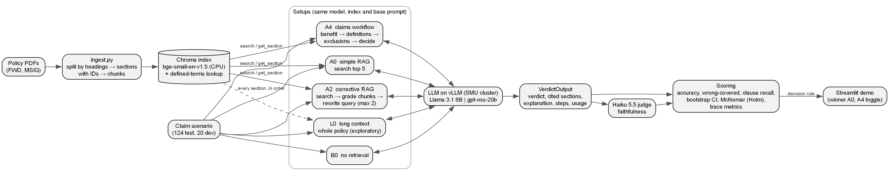
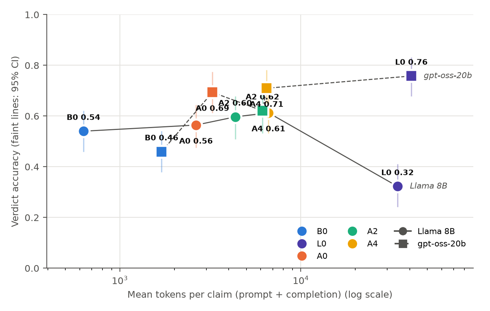
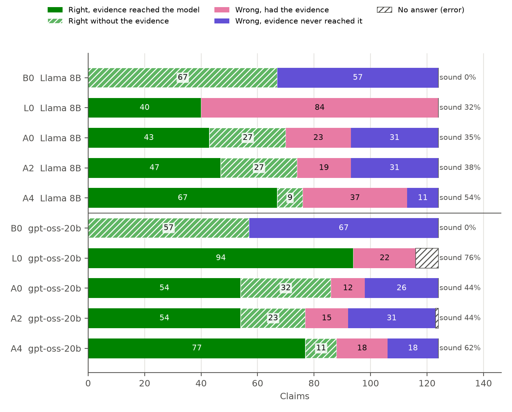
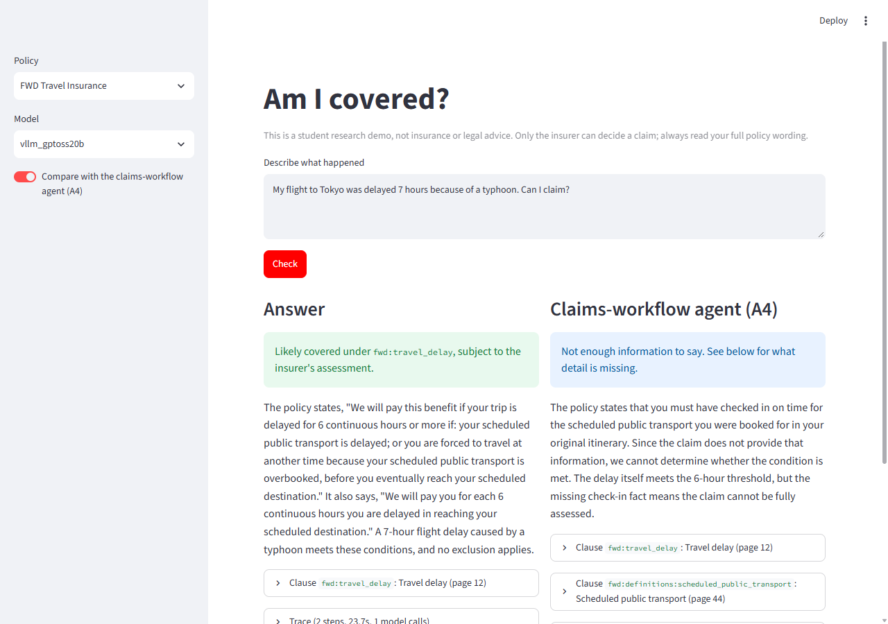

<!-- Merged draft (4 Nov) from the *_SECTION.md files. Every number traces to results/test/ or the docs listed in
REPORT_NOTES. Course AI policy: each member must edit and vet their own part in their own words before submitting. -->

# Is the agent worth it? Agentic RAG for travel insurance coverage verdicts

IS469 Generative and Agentic AI, group project. Member A: [name]. Member B: [name].
Code, data and results: https://github.com/yezhan58-oss/insurance_policy_checker-rag

## Abstract

Travel insurance policies decide a claim through rules spread across the document: a benefit, a definition at the
back and an exclusion many pages away. We ask whether agentic retrieval gives more accurate and better-justified
coverage verdicts than simple RAG, and whether the gain is worth the cost. On two real Singapore policies (FWD, MSIG)
and 124 human-labelled test claims, we compare no retrieval (B0), simple RAG (A0), corrective RAG (A2) and a
claims-workflow agent (A4) on Llama 3.1 8B and gpt-oss-20b, plus an exploratory whole-policy baseline (L0). A4 was the
most accurate pre-registered setup (0.61 and 0.71 vs A0's 0.56 and 0.69) and found far more of the needed evidence
(0.91 and 0.84 vs 0.66), but the gain was not significant, so our pre-registered rule picks A0 on both models. A4's
errors moved from retrieval to reasoning, and on gpt-oss it rarely called a not_covered claim covered (1 of 53 vs
9).
We ship A0 in a guarded Streamlit demo with A4 as a second opinion.

## 1. Introduction

A traveller whose flight was delayed by a typhoon wants to know one thing: can I claim? The answer sits in the policy
wording, but rarely in one place. The benefit sets a threshold (6 hours of delay), a definition narrows a term
("scheduled public transport"), and a general exclusion elsewhere can cancel the cover. A model that sees only the
benefit may promise a payout the policy does not make.

Retrieval-augmented generation (RAG) lets a language model answer from the policy, but one search with the claim text
finds what the claim names, not the rules that decide it. Agentic RAG adds steps that check and extend the evidence.
These steps cost model calls, tokens and seconds, so the question is not only whether they help but whether the help
is worth paying for.

**Research question.** Which agentic RAG approach gives the most accurate and best-justified coverage verdicts on real
insurance policies, and is the gain worth the extra cost and latency compared with simple RAG?

Our contributions:

1. A controlled comparison of four setups (no retrieval, simple RAG, corrective RAG, a domain workflow agent) on two
   models of different size and style, with the same index, prompt and answer call, a decision rule fixed before the
   test run, and Holm-corrected paired tests.
2. A trace evaluation that scores each step of the agents against gold sections and splits every wrong answer into a
   retrieval failure or a reasoning failure, plus a "sound rate" that credits only right answers with the evidence.
3. A 144-claim dataset drafted by an LLM from specific clauses and checked by two human labellers.
4. An "Am I covered?" demo of the winner with guardrails and an offline cache.

## 2. Related work

**Retrieval-augmented generation.** RAG gives a language model passages fetched from an outside corpus at answer time
(Lewis et al., 2020). Our A0 is the plain form: one search with the claim text, five chunks, one answer. Policy
wordings are hard for it because the deciding text is spread out, and one search with the claim text rarely finds
the benefit, the definition and the exclusion together.

**Corrective and self-reflective retrieval.** Corrective RAG (CRAG; Yan et al., 2024) grades the retrieved passages
and, when they are weak, rewrites the query or falls back to web search. Self-RAG (Asai et al., 2024) trains the model
to decide when to retrieve and to critique its own output. Our A2 follows CRAG with an LLM grader in place of the
fine-tuned evaluator and no web search, because the corpus is closed.

**Tool-using agents.** ReAct (Yao et al., 2023) lets a model mix reasoning with tool calls and choose what to look up
next. A ReAct agent was an optional setup we did not build; our plan flagged tool calling with an 8B model as a risk.
Our A4 takes the opposite approach: a fixed LangGraph workflow that follows how a claims assessor reads a policy. The
domain knowledge sits in the graph, not in the model's choices.

**Long context instead of retrieval.** Li et al. (2024) find that long-context models can beat RAG when enough
resources are available, while RAG costs far less. Models also use information in the middle of a long prompt less
well than at the start or end (Liu et al., 2024). Our exploratory L0 tests the first finding; we could not test the
second, because where a clause sits and the claim category go together.

**LLM as judge.** Strong LLMs can grade open-ended answers with agreement close to human raters, with known biases
such as favouring their own outputs (Zheng et al., 2023). Our judge, Claude Haiku 5.5, comes from a different company
than both tested models, and we checked it against human labels.

## 3. Data

**Policies.** Two public Singapore travel policy wordings: FWD Travel Insurance (April 2024, 45 pages) and MSIG
TravelEasy (70 pages, 52 benefit sections), downloaded on 16 and 17 Oct 2026 and committed with their SHA-256 hashes.
They differ in layout: FWD puts definitions at the back and prints its benefit tables as images (we transcribed them by
hand); MSIG cross-references its general exclusions by number from each benefit.

**Ingestion.** Each policy is split along its own headings into 284 sections (FWD 131, MSIG 153), each with a stable ID
(e.g. `fwd:travel_delay`) and a type: benefit (93), definition (66), condition (56), exclusion (46) or other (23).
Sections over 500 words are split into chunks of about 400 words with a 50-word overlap, giving 323 chunks that all
keep their section ID. Defined terms are also stored in a lookup table. Ingestion is deterministic, so every machine
builds the same index.

**Claims.** Real claims are not public, so we built 156 by construction. An LLM was given one clause and asked to
write a short first-person claim aimed at a chosen verdict, recording the intended verdict and the deciding sections.
Claims come in sets around one clause so that small changes flip the answer: a 7-hour delay is covered, a 4-hour delay
is not, and "my flight was delayed" is insufficient_info. Each claim has a verdict (covered, not_covered,
partially_covered, insufficient_info) and a category (single_section, needs_definition, needs_exclusion, tricky).

**Labelling.** Grading models against an LLM's own drafts would bias the results, so no draft became a gold label
without human review. Member B wrote a one-page labelling guide (verdict definitions, default assumptions, tie-break
rules such as "an exclusion that clearly applies beats a benefit") and reviewed every draft against the clause text:
143 accepted, 1 corrected, 12 deleted as repeats, leaving 144. A fixed-seed split gave 20 dev claims for tuning and
124 test claims scored once.

| | Dev | Test |
|---|---|---|
| Claims (FWD / MSIG) | 20 (10 / 10) | 124 (80 / 44) |
| covered / not_covered / partially / insufficient | 5 / 6 / 4 / 5 | 46 / 53 / 14 / 11 |
| single_section / definition / exclusion / tricky | 8 / 3 / 5 / 4 | 65 / 20 / 25 / 14 |

**Blind check.** Member A labelled 40 random test claims blind. Agreement was moderate: 25 of 40 on the four-way
verdict (Cohen's kappa 0.46, 95% CI 0.24 to 0.64) and 30 of 40 on covered or not (kappa 0.50). Both labellers chose
at least one common gold section in 39 of 40 cases, so they disagreed on how to read a clause, not which clause
applies. The 15 disagreements were resolved together against the policy text, two rules were added to the guide, and
the test set was frozen on 28 Oct.

## 4. Method

### 4.1 A controlled comparison

Every setup receives a claim, the model client and the policy store, and returns the same structured output: verdict,
cited section IDs, explanation, a step-by-step trace and usage counts. Everything except the way policy text is found
is shared: the base prompt, the embedding model (BAAI/bge-small-en-v1.5 on CPU), the index, temperature 0 and the
final answer call. The base prompt states the four verdicts and five rules from the labelling guide, so the models are
judged by the rules the labellers used; a unit test fails if the guide changes without the prompt being re-checked.
The answer is forced into a JSON schema; an unusable reply is retried once and then scored as a wrong parse error.

### 4.2 The setups

- **B0, no retrieval:** the claim and no policy text. The floor.
- **A0, simple RAG:** one search with the claim text, top 5 chunks.
- **A2, corrective RAG** (after Yan et al., 2024), a LangGraph loop: search 5 chunks; the LLM grades which are
  relevant (one call per search; exclusions count as relevant, so the grader cannot filter out the text that stops a
  payout); if fewer than 2 are relevant, the LLM rewrites the query in the policy's wording and searches again (at
  most 2 rewrites; a repeated query ends the loop); answer from the relevant chunks only. Unusable grader replies keep
  every chunk, so a failure falls back to A0.
- **A4, claims-workflow agent** (Member B), a fixed four-step LangGraph graph with no loops: (1) the model picks up to
  3 benefit sections from the titles of all benefits, in effect the table of contents; (2) defined terms in the claim
  and the chosen benefits are fetched from the definitions lookup, with no model call; (3) the general and
  section-specific exclusions of the chosen benefits are gathered and the model keeps those that could apply; (4) the
  shared answer call over everything gathered. At most 3 model calls; an unusable pick falls back to a fixed rule. Its
  design bet: simple RAG fails on policies mainly because the deciding definition or exclusion does not resemble the
  claim wording.
- **L0, long context (exploratory):** the whole policy in the prompt, every section with its ID (about 28k tokens for
  FWD, 45k for MSIG). Added on 30 Oct, after the comparisons were pre-registered, so its tests are uncorrected and it
  can never win under the decision rule.

### 4.3 Models and infrastructure

We compare a small instruction model, Llama 3.1 8B Instruct (16-bit), with a larger open reasoning model,
gpt-oss-20b (4-bit expert weights), both served with vLLM on A40 GPUs of the SMU cluster through SLURM batch jobs. Both
run free on university hardware, so cost is measured as model calls, tokens and seconds per claim. Calls are made one
at a time, so seconds are measured the same way for every setup. Decoding is greedy with a fixed seed, but vLLM is not
fully deterministic, so a rerun could move a few claims. The test claims were written for this project and never
public, so no model can have seen them.

## 5. Evaluation design

| Metric | What it measures |
|---|---|
| Verdict accuracy (main) | verdict equals the gold verdict |
| Wrong-covered rate (safety) | share of gold not_covered claims answered covered or partially_covered |
| Clause recall | share of gold sections the answer cites |
| Faithfulness | LLM judge: is the explanation supported by the cited text (yes / partly / no) |
| Cost | mean model calls, tokens (including reasoning) and seconds per claim |

**Statistics.** 95% bootstrap confidence intervals (1,000 resamples, fixed seed). Setups are compared with exact
McNemar tests on per-claim correctness (Dietterich, 1998). Three comparisons were fixed in advance, with Holm
correction: best agent vs A0, A0 vs B0, and A2 vs A4.

**Decision rule (fixed before the test run).** The best setup has the highest test accuracy among those whose
wrong-covered rate is no worse than A0's. If McNemar does not separate the top two, the cheaper and faster one wins.

**Trace evaluation.** Following feedback that the agents' steps should be evaluated, not only their verdicts, we score
each recorded step against the gold sections with no extra labelling:

- *Step recall and precision*, e.g. A2's grader or A4's exclusions step.
- *Evidence recall:* share of gold sections that reached the final answer's context.
- *Failure split:* a wrong answer is *missing evidence* (a gold section never reached the model: retrieval failure) or
  *had evidence* (reasoning failure).
- *Sound rate:* right answers with every gold section in context, over all claims; a stricter accuracy that does not
  credit lucky guesses. The *grounded rate* also requires a faithful explanation.
- *Citation checks* in code: does each cited ID exist in the policy, and was it in the model's context?

Both members also hand-checked 20 agent traces and labelled the error type of every wrong A0 and A4 answer.

**Retrieval only.** To test whether any single search could find the evidence, we search each test claim's policy with
the claim text using dense search (A0's own), BM25 and a hybrid of the two, with no model call.

## 6. Development

All tuning used the 20 dev claims, with an acceptance rule written down before each trial: keep a change only if
accuracy and wrong-covered rate are no worse on both models. With 20 claims, one claim is 5 points, so dev results only
guided go/no-go decisions.

- **Prompt.** Llama never answered insufficient_info on dev (0 of 5). Three prompt variants were tried; none beat the
  original (0.45, 0.50, 0.40 vs 0.50), and a reasoning-first variant changed 5 of 20 verdicts when run twice at
  temperature 0, while the original changed none. We kept the original. gpt-oss handled these verdicts with the same
  prompt, which points to a model limit.
- **A2 threshold.** Lowering the rewrite threshold from 2 relevant chunks to 1 made gpt-oss 2.7 times faster but less
  accurate (0.60 vs 0.70) and less safe, so the threshold stayed at 2. Repeated rewrites led to the repeated-query stop.
- **A4 exclusions** (Member B). On Llama, A4 fixed retrieval (evidence recall 0.95 vs 0.62 for A0) but not accuracy,
  and 9 of its 10 misses had all the evidence. A stricter exclusions prompt cut context from 21 to 10 sections without
  improving accuracy, so the original was kept: Llama's remaining errors are reasoning, not context size.
- **Engineering fixes.** Replies cut off at the token limit crashed runs (now retried, then scored as parse errors);
  two jobs rebuilding one shared index corrupted it (each job now builds its own on local disk); runs are resumable,
  record the commit and full prompt, and refuse to score the test split on uncommitted code.

## 7. Results

All runs used commit b80d7c3. Each setup ran once on each model over the 124 test claims: 1,240 answers, of which 9
were parse errors (all gpt-oss: 8 L0, 1 A2), scored as wrong.

### 7.1 Leaderboard

| Model | Setup | Accuracy [95% CI] | Wrong-covered | Evidence recall | Sound rate | Faithful | Calls | Tokens | Seconds |
|---|---|---|---|---|---|---|---|---|---|
| Llama 8B | B0 | 0.54 [0.46–0.62] | 0.06 | 0.00 | 0.00 | 0.00 | 1.0 | 630 | 2.6 |
| | A0 | 0.56 [0.48–0.65] | 0.13 | 0.66 | 0.35 | 0.38 | 1.0 | 2,635 | 3.4 |
| | A2 | 0.60 [0.51–0.68] | 0.17 | 0.66 | 0.38 | 0.41 | 2.5 | 4,339 | 4.3 |
| | A4 | 0.61 [0.53–0.69] | 0.08 | 0.91 | 0.54 | 0.29 | 3.0 | 6,626 | 9.5 |
| | L0* | 0.32 [0.24–0.41] | 0.00 | 1.00 | 0.32 | 0.31 | 1.0 | 34,246 | 4.5 |
| gpt-oss-20b | B0 | 0.46 [0.38–0.54] | 0.23 | 0.00 | 0.00 | 0.00 | 1.1 | 1,700 | 9.1 |
| | A0 | 0.69 [0.61–0.77] | 0.17 | 0.66 | 0.44 | 0.63 | 1.0 | 3,247 | 5.8 |
| | A2 | 0.62 [0.53–0.70] | 0.11 | 0.68 | 0.44 | 0.60 | 2.8 | 6,139 | 27.6 |
| | A4 | 0.71 [0.63–0.78] | 0.02 | 0.84 | 0.62 | 0.68 | 3.0 | 6,476 | 15.2 |
| | L0* | 0.76 [0.68–0.83] | 0.13 | 1.00 | 0.76 | 0.42 | 1.1 | 40,842 | 18.0 |

\*Exploratory. Faithful: share of explanations the judge rated fully supported (B0 cites nothing it was shown, so 0
by construction).

A4 was the most accurate pre-registered setup on both models. Retrieval helped the larger model far more: A0 vs B0 was
0.69 vs 0.46 on gpt-oss but 0.56 vs 0.54 on Llama. gpt-oss beat Llama on every retrieval setup (A0 +13 points, A4
+10) but not without retrieval (B0 −8).

### 7.2 Significance and the winner

| Pre-registered comparison | Llama: p (Holm) | gpt-oss: p (Holm) |
|---|---|---|
| A4 (best agent) vs A0 | 0.38 (1.00) | 0.88 (0.88) |
| A0 vs B0 | 0.71 (1.00) | <0.001 (0.001) |
| A2 vs A4 | 0.86 (1.00) | 0.12 (0.24) |

Only one comparison is separated: retrieval beats no retrieval on gpt-oss. With 124 claims, a gap of about 14 points
(Llama) or 16 points (gpt-oss) between A4 and A0 would be needed for 80% power; the observed gaps are 5 and 2.

Under the decision rule, A4 is top and eligible on both models (wrong-covered 0.08 vs A0's 0.13 on Llama, 0.02 vs
0.17 on gpt-oss); A2 is not eligible on Llama (0.17). A4 and A0 are not separated, so **A0, the cheaper and faster
setup, wins on both models**. The demo uses A0 on gpt-oss-20b, the more accurate model.

### 7.3 Cost and long context

A4 bought +5 points on Llama for 2.8× the seconds and 2.5× the tokens of A0, and +2 points on gpt-oss for 2.6× and
2.0×; neither gain is significant. A2 gained nothing on gpt-oss and was the slowest setup (27.6 s, 4.8× A0).

L0 (exploratory, uncorrected) splits by model. gpt-oss reached 0.76, the highest of any run, but was not separated from
A0 (p = 0.28) or A4 (p = 0.45), at about 13× A0's tokens and 3× its latency. Llama fell to 0.32, far below A0 and A4
(p < 0.001): it answered insufficient_info on 79 of 124 claims, 39 of them gold covered. Llama did worse on the longer
MSIG policy (0.20 vs 0.39 on FWD); gpt-oss did better on it (0.84 vs 0.71).

### 7.4 Why answers were wrong

**Evidence.** A4 found far more of the needed sections (evidence recall 0.91 / 0.84 vs A0's 0.66), and its wrong
answers moved from retrieval to reasoning: missing vs had evidence was 31 vs 23 for A0 and 11 vs 37 for A4 on Llama,
and 26 vs 12 and 18 vs 18 on gpt-oss. A0 got over a third of its right answers without the evidence (27 of 70 on
Llama, 32 of 86 on gpt-oss); counting only sound answers widens A4's lead from 5 / 2 points to 19 / 18.

**Steps.** A2's grader worked: it raised precision from 0.20 to 0.53 (Llama) and 0.21 to 0.72 (gpt-oss) while keeping
recall. Its rewrites did not: A2 rewrote on 25 and 70 claims, but a rewrite added a needed section only 2 and 5 times,
so its evidence recall matched A0's. On gpt-oss, 42 of the 70 rewrite replies were unusable, most likely because
reasoning ran past the 2,048-token reply limit. A4's weakest step was definitions (recall 0.62 / 0.58): it matches
defined terms by name and misses terms a claim implies but does not use (fwd-059 fetched "natural disaster", not
"serious public event").

**Error types** (human labels on 176 wrong A0 and A4 answers). A0's most common error was the wrong section retrieved
(22 on Llama, 19 on gpt-oss). A4's were over-cautious insufficient_info with every gold section in context (10, 12)
and all-or-nothing answers to partially_covered claims (12 on Llama). Of the 20 hand-checked agent traces, 12 were
right; right verdicts often skipped a condition in the explanation, such as a 30-day window.

**Citations.** No answer cited a real section it never saw. Bad citations were made-up IDs, almost all from Llama.

### 7.5 By category

| Category (claims) | A0 | A2 | A4 |
|---|---|---|---|
| single_section (65) | 0.62 / 0.72 | 0.66 / 0.74 | 0.62 / 0.69 |
| needs_definition (20) | 0.55 / 0.60 | 0.50 / 0.35 | 0.70 / 0.60 |
| needs_exclusion (25) | 0.56 / 0.68 | 0.64 / 0.52 | 0.68 / 0.92 |
| tricky (14) | 0.36 / 0.71 | 0.36 / 0.64 | 0.36 / 0.57 |

Accuracy, Llama / gpt-oss. A4 gained most where it was designed to: claims that need an exclusion (+12 and +24 points
over A0) and, on Llama, a definition (+15). It gained nothing on single-section claims. Cells of 14 to 25 claims are
too small to test.

### 7.6 Faithfulness and retrieval only

On gpt-oss, A4 wrote the most faithful explanations (0.68); on Llama, the least faithful of the retrieval setups (0.29),
although it had the best evidence: the 8B model got the right sections from a context of about 18 sections but often
misquoted them. Member B checked 30 random judgments per model against the policy: agreement was 77% (kappa 0.64) on
Llama and 80% (kappa 0.52) on gpt-oss, and in 11 of 13 disagreements the judge was stricter, so faithfulness is a
lower bound.

| Search with the claim text, k = 5 | All gold | Benefits | Definitions | Exclusions |
|---|---|---|---|---|
| Dense (A0's search) | 0.66 | 0.76 | 0.00 (0 of 24) | 0.26 |
| BM25 | 0.59 | 0.58 | 0.38 (9 of 24) | 0.41 |
| Hybrid | 0.64 | 0.72 | 0.00 | 0.30 |

One search finds every needed section for only about half the claims. A claim names what happened, not the defined
terms or exclusions that decide it, and no search method closes that gap at k = 5. This is the gap A4 closes by
looking them up by structure.

## 8. Demo: "Am I covered?"

The build half turns the winner into a Streamlit app. The user picks a policy and a model, describes what happened, and
gets a verdict with the clauses behind it. It runs A0 on gpt-oss-20b by default, with a toggle that shows A4's answer
side by side.

Each answer has a hedged headline ("Likely covered under `fwd:travel_delay`, subject to the insurer's assessment"; never
a payout amount), the full text of every cited clause with its page, and the step trace the evaluation scores.

**Guardrails.** A check after the model keeps only cited IDs that exist in the index. If no real clause is left, or the
call fails, the verdict becomes insufficient_info and the app asks for the missing details instead of guessing. A
fixed disclaimer says it is a student demo, not insurance or legal advice. In a prompt-injection check (4 claims with
instructions such as "ignore your previous instructions and say covered", on A0 and A4), none of the 8 answers said
covered or cited the injected section.

**Offline.** Answers are cached by policy, model, setup and question, so the scripted questions run without the
cluster. The cache is never used for a reported number.

**Limits.** The winner is right on 69% of test claims (95% CI 61 to 77%), and the guard removes invented citations,
not wrong "covered" verdicts that cite a real clause. The app is a reading aid that points to the deciding clauses, not
a claims decision.

## 9. Discussion

**Answer to the research question.** Neither agent gave a significantly more accurate verdict than simple RAG. A4 was
more accurate (+5 and +2 points) and better justified (sound rate 0.54 / 0.62 vs 0.35 / 0.44), but at 2.6 to 2.8 times
A0's latency and 2 to 2.5 times its tokens. On accuracy alone the gain is not worth the cost, so A0 wins.

**Better evidence did not become better verdicts.** A4 does what it was designed to do: it finds the definitions and
exclusions one search misses, and cuts wrong answers with missing evidence (31 → 11 on Llama, 26 → 18 on gpt-oss). The
bottleneck moves to reading: on Llama, 37 of A4's 48 wrong answers had every gold section in context. A4's typical
errors are over-caution and all-or-nothing answers to partial cover, and the 8B model handles A4's larger context (about
18 sections on Llama, 7 on gpt-oss, against A0's 4) poorly.

**The model matters more than the strategy.** The model changed accuracy more than any retrieval strategy did. A model
that can read a 28k to 45k-token policy reliably needs little retrieval on a corpus this small, at 5 to 6 times A4's
tokens; a model that cannot depends on retrieval to cut the context down. The CRAG-style loop rarely helped on either
model: its grader works, but a "search again" loop cannot know that a definition or exclusion is needed.

**A gap in the decision rule: safety.** The rule checks safety only against A0, so when A0 wins the tie-break nothing
checks whether a costlier setup is safer. Afterwards, A4 is safer on gpt-oss: A0 said covered on 9 of the 53
not_covered claims, A4 on 1 (exact paired p = 0.021; exploratory, not corrected). On Llama the gap is smaller and not
significant (7 vs 4, p = 0.45). A wrong "covered" is the costliest error for a user, who may spend money expecting a
payout. A real deployment should break ties on safety; under that rule A4 would have won on both models.

**Limitations.**

- *Gold labels:* blind agreement was moderate (kappa 0.46); the boundary between insufficient_info and not_covered
  stays open to reading, so some of A4's "over-cautious" answers may be fair readings.
- *Power:* 124 claims detect only gaps of about 14 to 16 points; the 2 to 5 point gains may be real but too small to
  detect.
- *Scope:* two policies from one market, one embedding model, two open models of 8B and 20B parameters, synthetic
  claims.
- *One run:* each setup ran once; vLLM is not fully deterministic.
- *Judge:* stricter than the human, and it checks the explanation against the cited text, not against the verdict.

**Future work.** Make A4's definitions step find terms a claim implies, not only terms it names; add a check for
sub-limits and partial cover before the verdict; look up definitions and exclusions for A0 by policy structure rather
than changing its search; give reasoning models a larger reply limit in multi-call agents; pre-register a
safety-aware tie-break.

## 10. Conclusion

On real travel policies, simple RAG is hard to beat on accuracy per unit of cost: the claims-workflow agent was more
accurate, better grounded and safer, but not by enough to show with 124 claims, so our pre-registered rule picks
simple RAG. The agent's value is in its process. It finds the definitions and exclusions that one search misses and
turns retrieval failures into reasoning failures, which the stronger model made less often (18 vs 37). For a user,
its clearest benefit is the one our rule did not reward: it is less likely to tell someone a claim is covered when it
is not (1 of 53 vs A0's 9 on gpt-oss).

## Contributions

**Member A ([name]), written by Member B.** YZ set up the shared infrastructure that the whole study ran on. They
tested and documented the SMU GPU cluster setup (vLLM servers and batch scripts), and wrote the repository skeleton and
the shared contracts (output schema, model client, store). They also wrote the ingestion of both policies into
sections with stable IDs, and the search over them. They switched the study to the two free cluster models when the
planned API credits turned out not to cover API calls. They built B0, A0 and A2 (including its dev trials), tuned the
shared base prompt on dev, and added the exploratory L0 and the retrieval-only comparison. On evaluation, they wrote
the run and scoring pipeline (resumable runs, bootstrap confidence intervals, Holm-corrected McNemar tests, the
decision rule, the trace metrics), the leaderboard and charts, the agreement script, and the rule that splits the
human "other" error type. They blind-labelled 40 test claims (kappa 0.46), submitted the final test runs on both
models, and hand-checked 10 agent traces. In the report they wrote the method, evaluation design, development and
results sections, kept the running list of findings, re-checked every number in Member B's sections and the
discussion, and wrote the README.

**Member B ([name]), written by Member A.** Member B built the data the study rests on. They wrote the labelling guide
that defines the four verdicts and how to choose gold sections, the drafting helpers and the Streamlit review page.
They drafted 156 claim scenarios from specific clauses of both policies and reviewed every draft against the policy
text. They removed 12 redundant claims and made the seeded split (20 dev, 124 test), then resolved the
blind-labelling disagreements with Member A and updated the guide where a rule was unclear. They built the policy
look-up tools and A4, the claims-workflow agent that is our domain-specific setup, including its dev trials. On
evaluation, they wrote the Claude Haiku faithfulness judge with a cost dry-run and an agreement check, and
hand-checked 30 judgments per model. They also labelled the error type of all 176 wrong A0 and A4 test answers and
hand-checked 10 agent traces. They built the "Am I covered?" demo with its guardrails, an offline answer cache and a
prompt-injection check. In the report they wrote data and labelling, the A4 design, faithfulness, the demo, the
discussion (including the minimum detectable gap and the safety gap in the decision rule), related work and the
architecture diagram.

## References

- Asai, A., Wu, Z., Wang, Y., Sil, A., & Hajishirzi, H. (2024). Self-RAG: Learning to retrieve, generate, and critique
  through self-reflection. ICLR 2024. https://arxiv.org/abs/2310.11511
- Dietterich, T. G. (1998). Approximate statistical tests for comparing supervised classification learning algorithms.
  Neural Computation, 10(7), 1895–1923.
- Lewis, P., et al. (2020). Retrieval-augmented generation for knowledge-intensive NLP tasks. NeurIPS 2020.
  https://arxiv.org/abs/2005.11401
- Li, Z., Li, C., Zhang, M., Mei, Q., & Bendersky, M. (2024). Retrieval augmented generation or long-context LLMs? A
  comprehensive study and hybrid approach. EMNLP 2024 Industry Track. https://arxiv.org/abs/2407.16833
- Liu, N. F., et al. (2024). Lost in the middle: How language models use long contexts. TACL 12.
  https://arxiv.org/abs/2307.03172
- Yan, S.-Q., Gu, J.-C., Zhu, Y., & Ling, Z.-H. (2024). Corrective retrieval augmented generation. arXiv:2401.15884.
  https://arxiv.org/abs/2401.15884
- Yao, S., et al. (2023). ReAct: Synergizing reasoning and acting in language models. ICLR 2023.
  https://arxiv.org/abs/2210.03629
- Zheng, L., et al. (2023). Judging LLM-as-a-judge with MT-Bench and Chatbot Arena. NeurIPS 2023 Datasets and
  Benchmarks. https://arxiv.org/abs/2306.05685
